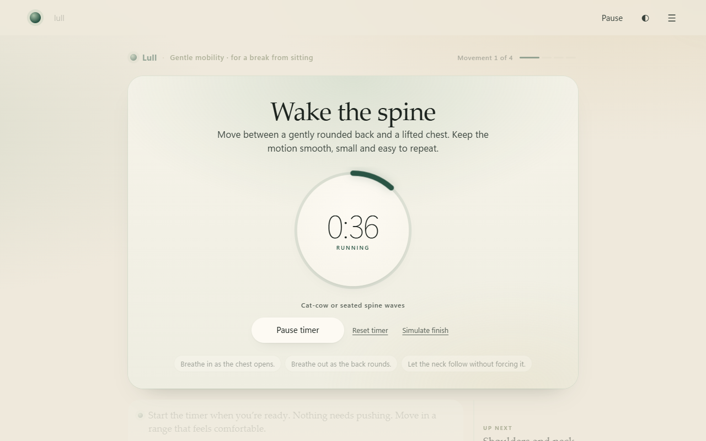

# Lull

**Live site:** https://lull-hr.vercel.app/

Three-minute guided movement breaks for teams who sit all day. Someone types how they feel, gets one short session, and Lull adjusts or stops as they go. Employers see team totals only, never a person.

Lull is a working prototype designed to support a first pilot, pending clinical, privacy and technical readiness checks. It includes the app, a page for HR and wellbeing buyers, a team view, a public safety page and a one-page pilot proposal. It runs entirely on your machine in a deterministic **Mock** mode: no account, no API key, no data leaves the page. All usage figures shown are made-up sample data, and labelled as such.



## Run it

Requires **Node.js 22.18 or later** and npm.

```sh
npm ci --ignore-scripts
npm start
```

Open http://127.0.0.1:5103 and stop with Ctrl+C. The port is set in the local `.env` file; change `PORT` there if 5103 is taken.

- **The app:** http://127.0.0.1:5103/
- **The page for teams:** http://127.0.0.1:5103/teams. This is a landing page for HR and wellbeing leads, with a pilot request form. The form is a prototype: it checks the fields, then says plainly that nothing was sent or saved.
- **The team view:** http://127.0.0.1:5103/#team-view shows what an employer would see, on sample data.
- **Safety and limits:** http://127.0.0.1:5103/safety covers how pain and symptoms are handled, what Lull never claims, the content review status (physiotherapist review is still pending for every session), and an accessibility statement with what hasn't been done yet. Tests check that the page's example phrases really trigger the safety response, and that its session lengths match the real timers.

For buyers there are two more things in `docs/`:
- **`Lull - Pilot Proposal.pdf`** is a one-page proposal for a six-week pilot, with targets agreed up front, privacy in plain English and an indicative price. The landing page offers it as a download. Its source is `docs/pilot/pilot-proposal.html`, printed to A4 with Chrome.
- **`concepts/chat-nudge.html`** is a design concept for opt-in reminders in team chat, shown on the landing page. It is labelled as not built, because it isn't.

## How Lull understands people

People type how they feel, in their own words. **Claude reads that; Lull's own code draws every screen.** Claude returns a checked interpretation (structured output), so it can't invent a movement, a duration or medical wording.

- **Safety has a floor.** A fixed list of words and phrases always runs. Claude can add caution ("my knee feels weird" → stop), never remove it. If Claude is unavailable, the list answers and Lull says so.
- **Tested.** `npm run eval` runs 44 realistic messages. Verified live on 2026-10-11 through the Claude plan route: see [eval/RESULTS.md](eval/RESULTS.md).
- **Two ways to run it.** `ALLOW_CLAUDE_PLAN=true` uses a Claude Pro or Max login through the official `claude` CLI. `ALLOW_CLAUDE_API=true` with `ANTHROPIC_API_KEY` uses the API. See [docs/RUNTIMES.md](docs/RUNTIMES.md).
- **For employers:** with Claude on, typed messages go to Anthropic to be read. The team view never shows typed text. The private on-device activity log keeps only messages Lull couldn't understand (up to 120 characters), and it can be turned off or cleared. Mock mode sends nothing.

## Two-minute tour

1. Click **Start Lull** and enter your first name, or skip it. That's the only question before the real one.
2. On "What are you in the mood for today?", tap a choice or type what today needs, for example *"I've been sitting all day"* or *"I only have five minutes"*. Lull says what it heard, suggests a session and its real duration, and waits for you to confirm.
3. In the workout:
   - **Start** the dial timer.
   - Type *"too easy"* in the companion area and confirm **Switch to steady**. You keep your place.
   - Try *"my shoulder hurts"* to see the safety hold. With Claude on, try *"ooh that pinched"* or *"my wrists are tired"* (you get a small change to the current movement).
4. Continue to the end for a calm, session-specific close, with an honest record of what the timers did.

Other entry points:
- `/workout [mobility|stretching|cardio] [gentle|steady]` loads a session directly.
- `/demo` loads a generic component sample.

## What it does

| Area | Behaviour |
| --- | --- |
| Onboarding | Two questions: an optional, validated first name, then what today needs. Revealed one at a time, so Next can't skip one. |
| Intent | Buttons or free text. With Claude on, Claude reads the need; otherwise a small deterministic layer normalises phrasing and maps needs (sitting, stiffness, time, energy, restlessness, calm, uncertainty, general fitness) onto existing sessions. It asks one question when unclear and is honest about what it can't guide. |
| Safety | Pain, injury, rehab or dizziness replaces the session choices with a safety notice. Mid-session, it pauses the timer and holds navigation until the user decides. Urgent symptoms get an urgent-care message and no route into exercise. |
| Sessions | Mobility, stretching and low-impact cardio, each at Gentle (4 blocks) or Steady (5 blocks, longer timers). Every duration shown is computed from the timers. |
| Workout stage | Movement name and instruction, a dial timer showing the real remaining time, movement-only progress, an Up next card, and a companion area for guidance, offers and "Tell Lull". |
| Adaptation | "Too easy", "make it gentler", "switch", "stop", or (with Claude) a small change to the current movement such as "my wrists are tired": an option is offered and applied only after confirmation, in place, keeping the user's context. |
| Ending | Session-specific closure that reconnects to the stated need, one word for something the session contained ("You met this in *Hip hinge reach*"), an optional breath, and a pressure-free suggestion for another day. The timer record (ran, ended early, reset, paused for safety, not started) is folded underneath. Nothing is claimed as physically completed. |

### The app experience

- **Home.** A greeting, one clear way in ("Start with Lull"), quick picks with their real durations, and a "Tell Lull what today needs" bar that works straight from home.
- **Focus mode.** While a timer runs, everything except the movement and the dial quietly steps back.
- **Keyboard.** <kbd>Space</kbd> starts or pauses the timer, <kbd>←</kbd>/<kbd>→</kbd> move between steps, and <kbd>Esc</kbd> closes the menu.
- **3-2-1 get-ready.** An optional countdown on the dial before a timer starts. It can be cancelled, and timers never start by themselves.
- **Breathing pacer.** On breathing blocks, the dial gently expands and settles in time with the real timer: 4 seconds in, 6 out.
- **Session overview.** Tap "Movement 2 of 5" to see every movement, its length and its state, and to jump to one.
- **Menu drawer.** Conversation history, settings and developer tools sit out of the way.
- **Evening mode.** Automatic, Day or Evening, built on the same colour tokens. Every text pair meets WCAG AA contrast.
- **Remember me (opt-in).** Your name, last session and the words you've picked up, stored only in this browser, with "Same as last time" on home. "Forget me" removes it.
- **Optional soft chime** when a timer runs out. It's off by default.
- **Installable.** A web app manifest, icons and a service worker let you add Lull to your desktop or home screen.
- **Accessibility.** A skip link, polite screen-reader announcements for timer changes, focus that follows each step, and reduced-motion support throughout.

## Product insights

Lull can show how it is being used, without sending anything anywhere.

- **Private activity log.** It counts product moments such as "chose a session", "started the first movement", "asked for an easier version" and "safety stop". The log is kept only in this browser. You can switch it off or clear it in Settings → Insights.
- **Insights screen** (Menu → Developer → Open product insights). It shows headline numbers, where people drop off, what they asked for, how they started, how it felt, requests Lull couldn't understand, and safety stops. Every chart has a table view. You can switch to a **synthetic sample** of 160 made-up people to see how the screen reads. The sample is clearly labelled and is not real usage.
- **Team view** (Insights → Team (sample)). This is what an employer would see in a pilot: people active each week, how many are still using it, totals by team, and when breaks happen. It never shows names, individual sessions, typed text or who reported pain. Teams under 10 people are hidden. If only one team is that small, one more is hidden too, so the small team can't be worked out by subtraction. The data is a made-up 64-person company, and it is labelled as such.
- **One-tap feeling question** at the end of a session: Lighter, About the same, Not for me, or Skip.
- **Two A/B experiments** (quick picks on home; countdown on by default). Each has its hypothesis next to it and an override for demos. The readout gives the gap with a 95% range and won't name a winner below 30 visits per variant.

The reasoning behind all of this (personas, metrics, backlog, business model, risks and a validation plan) is in **`docs/Lull - Product & Business Analysis.docx`**.


## How it's built

- **Declarative UI.** Every screen is OpenUI data: named statements, a validated component catalogue, and trusted local renderers. There's no generated code and no HTML injection.
- **Server** (`src/server/`):
  - `lull.ts`: onboarding, tones, sessions, intent, safety and endings.
  - `mock.ts`: routing for onboarding and in-session turns.
  - `guide.ts`: the Claude understanding layer (API or Claude plan CLI), the safety floor and the fallback. Its instructions are in `skills/guide.md`.
  - `vocabulary.ts`: the curated terms used for each session's word.
  - Optional full-screen OpenAI and Claude CLI adapters, which are off by default.
- **Browser** (`src/web/`):
  - `app.ts`: the workout stage, transitions and safety hold.
  - `components.ts`: renderers for the custom components (Profile, Recap, NameInput, TextInput, Rail).
  - `styles.css`: a single colour-token system.
- **Shared** (`src/shared/`): the conversation controller, plus the document, timer ledger and recap wording.
- **Live models.** `skills/guide.md` drives Claude (guided). `skills/workout.md` is a principle-based brief for the full-screen adapters.

See [docs/HARNESS.md](docs/HARNESS.md) for the architecture and the origin of the underlying harness.

## Checks

```sh
npm run check                      # typecheck, safety lint, unit + HTTP tests
npx playwright install chromium    # once
npm run test:ui                    # browser journeys
npm run eval                       # keyword layer vs Claude on 44 realistic messages
```

To use an installed Chrome for the browser tests, set `PLAYWRIGHT_CHROME_PATH`. On Windows, four tests are skipped with a stated reason: three need the full-screen Claude CLI runner (macOS and Linux only) and one needs symlinks (Developer Mode). The Claude (guided) plan route works on Windows.

## Honest limits

- In Mock, free-text understanding is a small keyword layer. Claude (guided) closes most of that gap, but the 44-message eval was written alongside the skill, so it shows the design works, not that it generalises.
- Claude adds a few seconds per typed message on the plan route.
- No voice, music or sensing. Memory is opt-in and stays in this browser.
- Insights numbers from the built-in sample are synthetic. Real numbers only come from your own use on your own device.
- Timers measure time on a page, not movement.
- Claude (guided) was verified live through the Claude plan route. The full-screen OpenAI and Claude CLI adapters have not been verified with real credentials.
- The landing-page screenshots predate the two-question onboarding.
