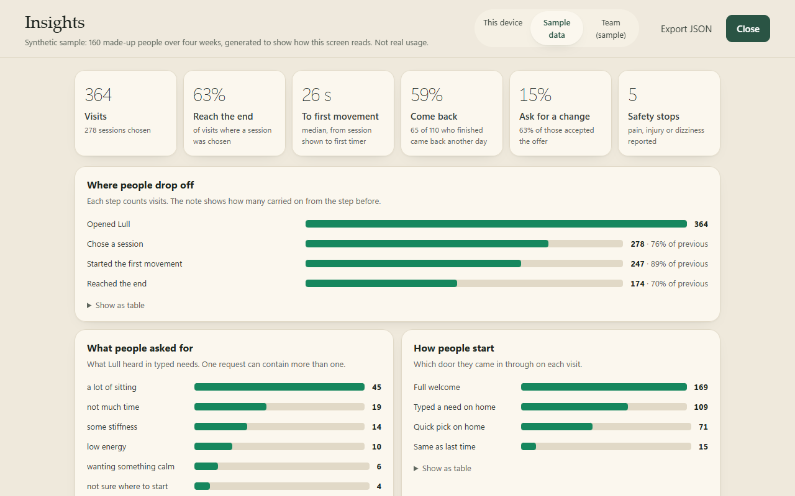

# Lull: 3-minute movement resets, with proof HR can share

**Live:** [Overview for HR](https://lull-hr.vercel.app/) · [Pilot details](https://lull-hr.vercel.app/pilot.html) · [Try the app](https://lull-hr.vercel.app/app/) · [Safety and limits](https://lull-hr.vercel.app/safety.html)

Lull is a pilot-stage workplace wellbeing product for HR teams at 50–500 person companies. Employees type how they feel, in English or Hinglish, and get one three-minute desk reset, seated or standing. HR sees whether teams are using it, without ever seeing a person.

## The problem it answers
Research behind the product (sources in the HR page's notes):
- Wellbeing benefits are widely offered but rarely used: about 30% of employees take part in programmes, and mental-health apps keep about 3% of users after 30 days.
- HR can't prove the spend worked, and employees distrust tools that can see individuals.
- Budgets are tight, and the founder usually approves.

## What's in the product
| For | What it does |
|---|---|
| Employees | Free-text need matching (English and Hinglish), five office-safe three-minute desk resets (seated or standing), a safety stop for pain or urgent symptoms (before or during a session), opt-in reminders on their own calendar or Slack, one-tap "your usual" from a reminder, team resets for meetings |
| HR | Team totals only; teams under 10 hidden; broad need categories per team; a week-6 report with targets agreed up front, cost per finished session and a downloadable slide |
| Privacy | One allow-list of anonymous counts (`src/shared/pilot.ts`), shown live to each employee under "What leaves this device", with a switch to turn counting off |
| Buying | Two-sided demo, personalised links (`?for=Company&ref=…`), pilot calculator, launch kit (Slack, email, manager note, QR desk card), sample report generator |

## Repo map
| Path | What |
|---|---|
| `src/` | The app: TypeScript, local server, Mock mode with no AI by default |
| `site/` | The public site (deployed on Vercel): `index.html` overview, `pilot.html`, `safety.html`, `thanks.html`, `report.html`, `card.html`, `404.html` |
| `site/app/` | The real app running fully in the browser, built with `npm run site:app` |
| `tests/` | `npm test`: 85 tests (80 pass, 1 timed out on http, 4 skipped on Windows), including the privacy contract (`pilot.test.mjs`) and Hinglish safety (`hinglish.test.mjs`) |
| `docs/` | **BRD, one-page case study and one pager** (`Lull - BRD.pdf`, `Lull - Case Study.pdf`, `Lull - One Pager.pdf`, editable sources in `docs/product/`), product and business analysis, pilot proposal |
| `eval/` | Safety evaluation of the pain-detection rules |

All usage figures shown anywhere are sample data from a made-up 64-person company (`src/shared/team.ts`). Lull is not a medical or mental-health service.

## Running a team pilot

1. **Give each pilot team its own link:** `https://lull-hr.vercel.app/app/?team=sales`. Only send it to teams of 10 or more; the code is cleaned to lower-case letters, digits and hyphens.
2. **What leaves an employee's device**, and nothing else (enforced by `src/shared/pilot.ts`, tested in `tests/pilot.test.mjs`): `session-started`, `session-finished`, `felt-lighter` / `felt-same` / `felt-not-for-me`, `need-<category>` (the first broad category Lull heard, e.g. `need-stiff`, from a fixed list), `reminder-set` (once per device), `came-back`, `opened-from-reminder`, `team-reset-joined`. No name, device ID, typed text or anything about pain or safety is ever sent. Each person sees the exact list under **Settings → What leaves this device** and can switch counting off.
3. **Reminders belong to the employee.** After a session, "Make it a habit" adds a weekday reminder to their own Google, Outlook or Apple calendar, or copies a Slack `/remind` command. Lull never sends reminders itself.
4. **Reading the numbers:** in GoatCounter (`lull.goatcounter.com`), events appear as `pilot/<team>/<event>`. GoatCounter counts events, not people; use them for the week-3 check-in and the week-6 report, and never show a team under 10.
5. **Team resets:** `https://lull-hr.vercel.app/app/?reset=unknot-seated&team=sales` opens that reset straight away for everyone in a meeting. Only `unknot|unsit|energy|calm|screen` × `seated|standing` are accepted.
6. **Launch kit:** the HR page has ready Slack, email and manager messages, and a printable desk card with a QR code (`card.html?for=Company&team=sales`).
7. **Understands Hinglish:** everyday words like "gardan akad gayi" or "thak gaya hoon" are understood, and Hinglish pain words ("kamar mein dard", "seene mein dard") stop a session exactly like English ones (`tests/hinglish.test.mjs`).
8. **Leading indicator for week 3:** the share of the team with `reminder-set`. If few people set a reminder, return rates will fall like every other tool, and that is the thing to fix first.

The local app (`npm start`) never sends pilot counts: its Content Security Policy only allows its own origin.

## Run it

Requires **Node.js 22.18 or later** and npm.

```sh
npm ci --ignore-scripts
npm start
```

Open http://127.0.0.1:4319 and stop with Ctrl+C. To use another port, copy `.env.example` to `.env` and change `PORT`.

- **The app:** http://127.0.0.1:4319/
- **The page for teams:** http://127.0.0.1:4319/teams. A short page with the same promise as the HR site, linking to a reset, the sample team view, safety and the pilot proposal. The full HR site is in `site/` and live at https://lull-hr.vercel.app/.
- **The team view:** http://127.0.0.1:4319/#team-view shows what an employer would see, on sample data.
- **Safety and limits:** http://127.0.0.1:4319/safety covers how pain and symptoms are handled, what Lull never claims, the content review status (physiotherapist review is still pending for every reset), and an accessibility statement with what hasn't been done yet. Tests check that the page's example phrases really trigger the safety response, and that its reset lengths match the real timers.

For buyers, `docs/` also has:
- **`Lull - Pilot Proposal.pdf`** is a one-page proposal for a six-week pilot, with targets agreed up front, privacy in plain English and an indicative price. The HR site and the `/teams` page offer it as a download. Its source is `docs/pilot/pilot-proposal.html`, printed to A4.

## How Lull understands people

People type how they feel, in their own words. **Claude reads that; Lull's own code draws every screen.** Claude returns a checked interpretation (structured output), so it can't invent a movement, a duration or medical wording.

- **Safety has a floor.** A fixed list of words and phrases always runs. Claude can add caution ("my knee feels weird" → stop), never remove it. If Claude is unavailable, the list answers and Lull says so.
- **Tested.** `npm run eval` runs 44 realistic messages. On the safety side, the word list alone misses 10 of 14 body concerns and the list plus Claude missed none (live run, 2026-10-11; the safety word list has since only been extended, with Hinglish words). Routing to the five resets was re-scored on the keyword layer after the rebuild; a fresh live Claude run is still to do. See [eval/RESULTS.md](eval/RESULTS.md) and the archived [live run](eval/LIVE-RUN-2026-10-11.md).
- **Two ways to run it.** `ALLOW_CLAUDE_PLAN=true` uses a Claude Pro or Max login through the official `claude` CLI. `ALLOW_CLAUDE_API=true` with `ANTHROPIC_API_KEY` uses the API. See [docs/RUNTIMES.md](docs/RUNTIMES.md).
- **For employers:** with Claude on, typed messages go to Anthropic to be read. The team view never shows typed text. The private on-device activity log keeps only messages Lull couldn't understand (up to 120 characters), and it can be turned off or cleared. Mock mode sends nothing.

## Two-minute tour

1. Click **Start with Lull**. One question: *"How are you feeling right now?"* Tap a work moment (After back-to-back calls, Stiff from sitting, Post-lunch slump, Stressed, can't switch off, Tired eyes and wrists) or type it in your own words, even in Hinglish: *"gardan akad gayi"*, *"neck is stiff and I'm on a call in 5"*.
2. Lull says what it heard and suggests **one** reset with its reason and real length. Start it **seated** (works on a call, camera off) or **standing** (beside your desk), or pick something else.
3. In the reset:
   - **Start** the dial timer. Four short steps, about three minutes in total.
   - Type *"too easy"* and confirm **Switch to standing**, or *"joining a call"* and confirm **Switch to seated**. You keep your place.
   - Try *"my shoulder hurts"* or *"kamar mein dard"* to see the safety hold.
4. The end says **"Back to your day."**, with an honest record of what the timers did, the optional "How did that feel?", and **Make it a habit**: a weekday reminder on your own calendar or Slack, or a team reset for a meeting.

Other entry points:
- `/reset [unknot|unsit|energy|calm|screen] [seated|standing]` loads a reset directly.
- `/demo` loads a generic component sample.

## What it does

| Area | Behaviour |
| --- | --- |
| First screen | One question, "How are you feeling right now?", with five work moments or free text. No name, no profile questions. |
| Understanding | Buttons or free text, in English or Hinglish. With Claude on, Claude reads the need; otherwise a deterministic layer maps it onto a reset (neck and shoulders, back and hips, energy, calm, eyes and wrists) and reads context such as "on a call" to suggest seated. It asks one question when unclear and is honest about what it can't do. |
| Safety | Pain, injury, rehab or dizziness, in English or Hinglish, replaces the choices with a safety notice. During a reset, it pauses the timer and holds navigation until the person decides. Urgent symptoms get an urgent-care message and no route into movement. |
| Resets | Unknot neck & shoulders, Undo the sitting, Energy lift, Calm down, Screen break. Each has the same four steps seated or standing, about three minutes. Office-safe: work clothes, nothing on the floor, no sweat. Every duration shown is computed from the timers. |
| Reset stage | Step name and instruction, a dial timer showing the real remaining time, step progress, an Up next card, and an area for guidance, offers and "Tell Lull". |
| Adaptation | "Too much", "on a call" or "can I sit?" offer the seated version; "too easy" offers standing; "something calmer" offers another reset; "stop" ends early. Each is offered and applied only after confirmation, keeping your place. |
| Ending | "Back to your day.": one line on what the reset made room for, an optional breath, another reset to try another time, and the timer record folded underneath. Nothing is claimed as physically completed. |

### The app experience

- **Home.** "Between calls? Take three minutes." One clear way in, the five work moments with their real lengths, and a "Tell Lull" bar that works straight from home.
- **Focus mode.** While a timer runs, everything except the step and the dial quietly steps back.
- **Keyboard.** <kbd>Space</kbd> starts or pauses the timer, <kbd>←</kbd>/<kbd>→</kbd> move between steps, and <kbd>Esc</kbd> closes the menu.
- **3-2-1 get-ready.** An optional countdown on the dial before a timer starts. It can be cancelled, and timers never start by themselves.
- **Breathing pacer.** On breathing steps, the dial gently expands and settles in time with the real timer: 4 seconds in, 6 out.
- **Reset overview.** Tap "Step 2 of 4" to see every step, its length and its state, and to jump to one.
- **Make it a habit.** After a reset, a weekday reminder on the person's own calendar or Slack, a team reset invite for meetings, and one tap to "your usual" when a reminder opens Lull.
- **Menu drawer.** Conversation history, settings ("What leaves this device", your reset time) and developer tools sit out of the way.
- **Evening mode.** Automatic, Day or Evening, built on the same colour tokens. Every text pair meets WCAG AA contrast.
- **Remember me (opt-in).** Your last reset, stored only in this browser, with "Same as last time" on home. "Forget me" removes it.
- **Optional soft chime** when a timer runs out. It's off by default.
- **Installable.** A web app manifest, icons and a service worker let you add Lull to your desktop or home screen.
- **Accessibility.** A skip link, polite screen-reader announcements for timer changes, focus that follows each step, and reduced-motion support throughout.

## Product insights

Lull can show how it is being used, without sending anything anywhere.

- **Private activity log.** It counts product moments such as "chose a reset", "started the first step", "asked for the seated version" and "safety stop". The log is kept only in this browser. You can switch it off or clear it in Settings → Insights.
- **Insights screen** (Menu → Developer → Open product insights). It shows headline numbers, where people drop off, what they asked for, how they started, how it felt, requests Lull couldn't understand, and safety stops. Every chart has a table view. You can switch to a **synthetic sample** of 160 made-up people to see how the screen reads. The sample is clearly labelled and is not real usage.
- **Team view** (Insights → Team (sample)). This is what an employer would see in a pilot: people active each week, how many are still using it, totals by team, and when breaks happen. It never shows names, individual sessions, typed text or who reported pain. Teams under 10 people are hidden. If only one team is that small, one more is hidden too, so the small team can't be worked out by subtraction. The data is a made-up 64-person company, and it is labelled as such.
- **One-tap feeling question** at the end of a reset: Lighter, About the same, Not for me, or Skip.
- **Two A/B experiments** (quick picks on home; countdown on by default). Each has its hypothesis next to it and an override for demos. The readout gives the gap with a 95% range and won't name a winner below 30 visits per variant.

The reasoning behind all of this (personas, metrics, backlog, business model, risks and a validation plan) is in **`docs/Lull - Product & Business Analysis.docx`**.



## How it's built

- **Declarative UI.** Every screen is OpenUI data: named statements, a validated component catalogue, and trusted local renderers. There's no generated code and no HTML injection.
- **Server** (`src/server/`):
  - `lull.ts`: the five resets (seated and standing), the first screens, need understanding, safety and endings.
  - `mock.ts`: routing for the first screens and in-reset turns.
  - `guide.ts`: the Claude understanding layer (API or Claude plan CLI), the safety floor and the fallback. Its instructions are in `skills/guide.md`.
  - Optional full-screen OpenAI and Claude CLI adapters, which are off by default.
- **Browser** (`src/web/`):
  - `app.ts`: the reset stage, transitions and safety hold.
  - `components.ts`: renderers for the custom components (Profile, Recap, NameInput, TextInput, Rail).
  - `pilot.ts` and `reminder.ts`: anonymous team-pilot counts and the opt-in reminders.
  - `styles.css`: a single colour-token system.
- **Shared** (`src/shared/`): the reset catalogue (`resets.ts`), the pilot privacy contract (`pilot.ts`), the conversation controller, plus the document, timer ledger and recap wording.
- **Live models.** `skills/guide.md` drives Claude (guided). `skills/reset.md` is a principle-based brief for the full-screen adapters.

See [docs/HARNESS.md](docs/HARNESS.md) for the architecture and the origin of the underlying harness.

## Checks

```sh
npm run check                      # typecheck, safety lint, unit + HTTP tests
npx playwright install chromium    # once
npm run test:ui                    # browser journeys
npm run eval                       # keyword layer vs Claude on 44 realistic messages
```

To use an installed Chrome for the browser tests, set `PLAYWRIGHT_CHROME_PATH`. On Windows, four tests are skipped with a stated reason: three need the full-screen Claude CLI runner (macOS and Linux only) and one needs symlinks (Developer Mode). The Claude (guided) plan route works on Windows.

## Honest limits

- In Mock, free-text understanding is a small keyword layer (18 of 44 eval messages). Claude (guided) closes most of that gap, but the 44-message eval was written alongside the skill, so it shows the design works, not that it generalises.
- Claude adds a few seconds per typed message on the plan route.
- No voice, music or sensing. Memory is opt-in and stays in this browser.
- Insights numbers from the built-in sample are synthetic. Real numbers only come from your own use on your own device.
- Timers measure time on a page, not movement.
- Claude (guided) was verified live through the Claude plan route. The full-screen OpenAI and Claude CLI adapters have not been verified with real credentials.
